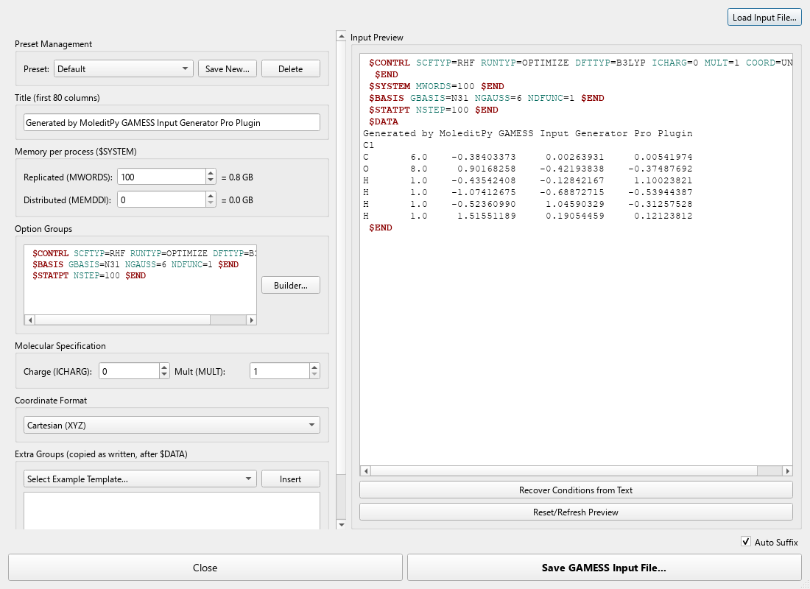
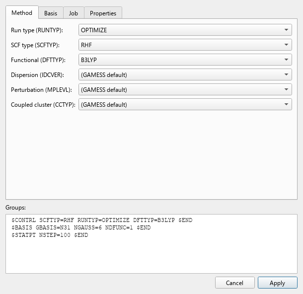
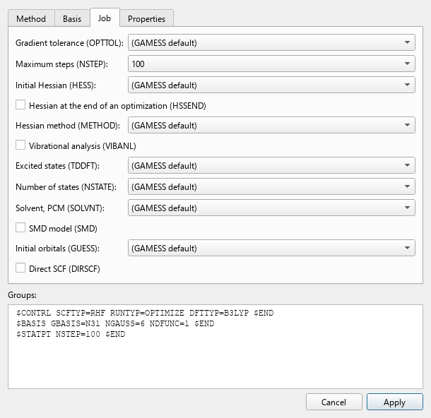

# MoleditPy GAMESS Input Generator Pro

A plugin for MoleditPy that writes GAMESS (US) input files from the molecule on
screen, and reads them back. It is at version 1.0.0.

This plugin is an independent project and is not affiliated with or endorsed by the
Gordon Group at Iowa State University. It writes text files; you need your own copy of
GAMESS to run them.

## Screenshots

| Group builder: method | Group builder: job |
|---|---|
|  |  |

## Features

- **Group builder**: tabs for method, basis, job and properties. It reads the groups
  you already have, changes only what you pick, and keeps every keyword it has no
  control for.
- **Run types**: `ENERGY`, `GRADIENT`, `OPTIMIZE`, `HESSIAN`, `SADPOINT`, `NMR`, `RAMAN`.
- **Methods**: RHF, UHF and ROHF; 27 DFT functionals with D3 or D3(BJ); MP2; coupled
  cluster from LCCD to CR-CC(Q); TD-DFT.
- **Basis sets**: 34 built-in sets. `ISPHER=1` is added for the ones that need it
  (correlation-consistent, PCseg, Sapporo, KTZV).
- **Solvent**: PCM with 17 named solvents, and SMD.
- **Coordinates**: Cartesian under C1, Z-matrix, or Z-matrix with variables, in
  Angstrom or with `UNITS=BOHR`. A ghost atom keeps its element's basis through a
  negative nuclear charge. A linear reference or a ghost in a Z-matrix falls back to
  Cartesian, and the window says so.
- **Memory**: `MWORDS` and `MEMDDI`, with the size in GB beside them.
- **Extra groups**: `$HESS`, `$DIPDR` and `$VEC` from a punch file go in as written,
  so Raman, a read Hessian and `MOREAD` all work.
- **Warnings** for what GAMESS would refuse, listed below, before you submit anything.
- **Live preview** that you can edit. **Recover Conditions from Text** brings an edited
  or loaded input back into the controls.
- **Loading**: **File > Import**, **File > Open** or a drop. `.inp` is ORCA's extension
  too, so the file's groups are checked first and anything else goes on to the plugin
  that handles it.
- **Presets**, auto suffix on the file name by run type, session persistence, and
  **Submit to Cluster** when the Job Manager plugin is installed.

## What GAMESS refuses, and the window warns about

| Input | GAMESS 2024 R2 prints |
|---|---|
| `SCFTYP=RHF` with `MULT` above 1 | `SCFTYP=RHF MUST HAVE MULT=1` |
| Electron count that cannot have the multiplicity | `CHECK YOUR INPUT CHARGE AND MULTIPLICITY` |
| `CCSD` or `CCSD(T)` with `MEMDDI=0` | `INSUFFICIENT DISTRIBUTED MEMORY` |
| Any other `CCTYP` in parallel | `ONLY CCTYP=CCSD OR CCTYP=CCSD(T) CAN RUN IN PARALLEL` |
| More than one of `DFTTYP`, `MPLEVL`, `CCTYP` | `AT MOST ONE CORRELATION METHOD` |
| `RUNTYP=NMR` with DFT, an open shell, `DIRSCF` or more than one core | `INCOMPATIBLE OPTION CHOSEN WITH RUNTYP=NMR` |
| A correlation-consistent or PCseg set without `ISPHER=1` | `PLEASE SET ISPHER=1` |
| `RUNTYP=SADPOINT` with neither a `$HESS` nor `HESS=CALC` | `DID NOT SUPPLY A $HESS GROUP` |
| `RUNTYP=RAMAN` without `$HESS` and `$DIPDR` | `RAMAN SPECTRUM REQUIRES` |

Opening a molecule with unpaired electrons, or raising the multiplicity, turns RHF into
ROHF. The builder writes `HESS=CALC` for a saddle point.

## Known limitations

- Input is written under C1. GAMESS finds no symmetry for you, and the plugin does not
  look for any.
- A loaded input with other symmetry, `COORD=HINT`, `ZMTMPC`, `PRINAXIS` or `FRAGONLY`
  stays editable as text but draws no structure, since the plugin cannot expand it.
- GAMESS has no scan keyword and this plugin has no constraint table, so neither is
  offered. There are no NBO controls either: the standard build has no NBO.
- `$DATA` with per-atom basis sets loads, but the window writes `$BASIS` only.
- The core count is not part of a GAMESS input. Set it where you run the job.

## What each claim is tested with

`tests/verified_inputs` holds the files this code writes, and each was run with GAMESS
2024 R2. `RESULTS.json` records how each ended.

- `tests/claimed_features.py` lists every claim above with the job that backs it.
  Every functional, basis set, coupled-cluster type and solvent in the builder has a
  finished job of its own, and each warning has a job GAMESS really refused.
- `tests/test_verified_inputs.py` fails when the code stops writing those exact files.
  It also checks what only correct cards could give: Bohr and Angstrom, plain and
  variable Z-matrices give the same energy; a dummy changes nothing; a ghost's basis
  lowers the energy by a small amount.
- `tests/test_real_dialog.py` opens the real window under Qt, presses every button and
  tries every builder choice.

## Installation

Install it through the MoleditPy Plugin Installer once it is registered, or copy the
`gamess_input_generator_pro` folder into your plugins folder.

## Requirements

- MoleditPy 5.0 or later
- PySide6 and RDKit, provided by MoleditPy

## License

LGPL-3.0-or-later. See [LICENSE](LICENSE), [COPYING](COPYING) and [LICENSING.md](LICENSING.md).
